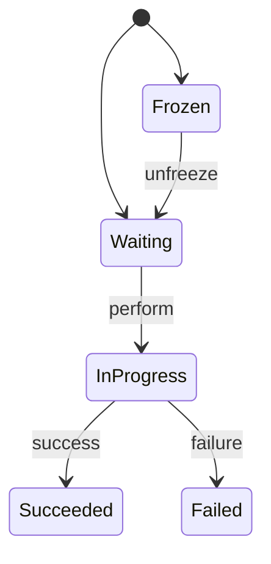

# ICE：候选与选路

一个端可能有多个可被连上的地址：每块网卡一个内网地址、可能有 IPv6、NAT 之后的公网映射、中继服务分配的地址。两个这样的端要建立一条可用的直接传输，必须回答三个问题：双方各有哪些候选地址？哪一对地址之间真正能通？双方如何就"用哪一对"达成一致？ICE（Interactive Connectivity Establishment，[RFC 8445](https://www.rfc-editor.org/info/rfc8445)）回答这三个问题。

本文依据 RFC 8445 整理其机制。规范要求、本文的解释、实现行为三者分开陈述；条款号未注明出处的一律指 RFC 8445。

## 1. 解决什么问题

地址选择没有中心裁决：NAT 与防火墙使"从 A 能到 B"不意味着"从 B 能到 A"，且每个地址的可达性事先未知。ICE 的做法（§2）：

1. 每端收集自己的全部候选地址（§5.1.1）；
2. 通过信令通道把候选与凭据交换给对端——WebRTC 中由 SDP 承载；
3. 两端候选两两配对、按优先级排序，用 STUN 报文在每对地址之间做真实的端到端检查（§7）；
4. 由 controlling 一方提名最终选定的地址对（§8）。

ICE 假设信令通道已经存在，但不规定它是什么。这是 WebRTC"信令不在规范内"的直接原因：ICE 需要的只是候选和凭据能到对端手里。

## 2. 候选：一个端的可达身份

**候选**（candidate）是一个传输地址加上一组属性：类型、优先级、foundation、base（§4）。两个术语先行：

- **component**：需要独立的传输地址才能工作的那部分数据流（§4）。RTP/RTCP 不复用端口时是两个 component；WebRTC 把媒体与数据都复用在单个 component（ID 为 1）上。
- **base**：候选从中派生的本机接口地址（§4）。host 候选的 base 是它自己；srflx 候选的 base 是当初向 STUN 服务器发请求的那个本机地址。reflexive 候选不能直接作为报文源——检查一律从 base 发出（§6.1.2.4）。

四类候选：

| 类型 | 来源 | 说明 |
| --- | --- | --- |
| `host` | 绑定本机接口地址（§5.1.1.1） | 同网段（或 VPN）内可直接到达。 |
| `srflx` | STUN/TURN 服务器报告的本端公网映射（§5.1.1.2） | 能否使用取决于 NAT 行为。 |
| `relay` | TURN 服务器为本端分配的中继地址（§5.1.1.2） | 以中继流量为代价，几乎总是可达。 |
| `prflx` | 检查过程中从对端报文里发现（§5.1.1、§7.3.1.3） | 不是收集来的，是 §4 检查的副产物。 |

收集发生在通信即将开始时（§5.1.1）：枚举接口得 host 候选；向每个配置的 STUN 服务器发 Binding 请求得 srflx 候选；配了 TURN 再得 relay 候选。类型与 base 都相同的候选被丢弃（§5.1.3）。WebRTC 实现通常不等收集完成就开始交换（trickle），候选逐个经信令补发。

**foundation**（§5.1.1.3）：同类型、同 base IP、取自同一 STUN/TURN 服务器的候选共享一个 foundation。它供冻结算法（§6.1.4.3）把"连通性大概率相同"的候选分批检查。

**浏览器的 mDNS 行为**（实现行为，非协议要求）：浏览器把 host 候选的地址写成随机 mDNS 名而非 IP。同网段对端解析后照常检查；跨网段对端解析失败，该候选自然失效。收益是网页脚本拿不到用户内网 IP，代价是 host 候选实际只服务同网段。native 实现（如 [webrtc-rs](https://github.com/webrtc-rs/webrtc)）不这样做——浏览器与 native 两端候选列表不对称是常态。

## 3. 两个优先级公式

### 3.1 候选优先级

每个候选带一个 1 到 $2^{31}-1$ 的优先级。规范建议的公式（§5.1.2.1）：

$$\text{priority} = 2^{24}\cdot\text{type pref} + 2^{8}\cdot\text{local pref} + (256 - \text{component ID})$$

参数约束（§5.1.2.2）：

- type pref 取 0–126；同类型的候选必须相同，不同类型必须不同；prflx 必须高于 srflx。建议值：host 126、prflx 110、srflx 100、relay 0。
- local pref 取 0–65535，表达同类型内部的本地偏好（多网卡、VPN 场景）；单地址建议取 65535。
- 同一 agent 内任意两个候选的优先级必须互不相同（component ID 项保证这一点）。

按建议值、单地址、component 1 代入：

| 类型 | 计算 | 优先级 |
| --- | --- | --- |
| host | $126 \cdot 2^{24} + 65535 \cdot 2^{8} + 255$ | 2130706431 |
| prflx | $110 \cdot 2^{24} + 65535 \cdot 2^{8} + 255$ | 1862270975 |
| srflx | $100 \cdot 2^{24} + 65535 \cdot 2^{8} + 255$ | 1694498815 |
| relay | $0 + 65535 \cdot 2^{8} + 255$ | 16777215 |

数字可直接验证：优先级写成十六进制后，最高字节就是 type pref。注意优先级只决定**尝试顺序**，不是淘汰规则——host 不通时 srflx 照样顶上。

### 3.2 候选对优先级

候选对（candidate pair）的优先级不是两端候选优先级之和，而是（§6.1.2.3）：

$$\text{pair priority} = 2^{32}\cdot\min(G, D) + 2\cdot\max(G, D) + (G > D\ ?\ 1\ :\ 0)$$

$G$ 是 controlling 端候选的优先级，$D$ 是 controlled 端的。min 占最高位的设计使排序由**较弱的一端主导**：一对里出现再强的候选，也救不了另一端的 relay；反之任一端变强，整对前移。这个性质也保证两端各自算出的排序一致（§6.1.2.3，设计动机见附录 B.5）。

检查表按 pair priority 降序排列；整个检查表集合的候选对总数默认限 100 对、必须可配（§6.1.2.5）。

![[ice-priority]]

## 4. 连通性检查

检查（connectivity check）是一次 STUN Binding 事务：从本地候选的 base 向对端候选的传输地址发请求，收到成功响应、且响应证明路径对称，该候选对在这个方向上有效（§7.2.5）。四个要点：

1. **凭据**（§7.2.2）。检查用 STUN 短期凭据：请求的 USERNAME 是"对端 ufrag : 本端 ufrag"，完整性用对端的 ice-pwd 计算。没拿到对端凭据就发不出合法检查——在 WebRTC 里这意味着必须先经信令交换 SDP。凭据同时防第三方伪造：拿不到 pwd 的报文通不过完整性校验。
2. **对称判据**（§7.2.5.2.1）。成功响应必须从对端候选的地址发出、且发回到发起检查的源地址；不对称即失败。
3. **与数据同端口**。检查报文与之后的 DTLS/SCTP/应用数据共用同一 IP 与端口，按首字节解复用（规则见 RFC 7983）。
4. **PRIORITY 属性**（§7.1.1）。请求携带的 PRIORITY 不是本候选的优先级，而是"假设对端把这个源地址学成 prflx 候选"时应取的优先级——为下面的 prflx 发现做准备。

### 4.1 检查表与状态机

每个 component 一张检查表（checklist，§6.1.2），候选对处于五种状态之一（§6.1.2.6）：

调度不是"全部同时发"：新检查按 pair priority 从高到低、以 Ta 间隔发出，Ta 默认 50 ms（§14.2）；重传超时随检查表规模放大，使所有对的首轮检查先于任何重传（§14.3）。实践中一次选路通常在几十到几百毫秒内完成。

### 4.2 triggered check 与 prflx

对端也可能先发检查过来（§7.3）：

- 收到源地址不在已知候选里的检查请求时，按请求的 PRIORITY 属性登记一个 prflx 远端候选（§7.3.1.3），并对该地址**立即**排一个 triggered check（§7.3.1.4）；
- 自己发出的检查得到未知映射地址的响应时，同样登记 prflx（§7.2.5.3.1）。

triggered check 保证"你测我"必然引发"我测你"：一个候选对要**双向都确认**才进入 valid list（§7.2.5.3.2）。prflx 是 ICE 适应对称 NAT 的关键机制之一——STUN 服务器看到的映射地址（srflx）在对称 NAT 下对别的目的地无效，真正可用的映射靠对端检查报文的实际到达地址暴露出来。

## 5. 角色、提名与结束

**角色**（§6.1.1）：双方都是 full 实现时，发起 ICE 会话的一端为 controlling，负责提名（WebRTC 中即 offerer）。角色对不齐时，收到冲突的检查以 487 Role Conflict 拒绝，双方按 64 位随机 tie-breaker 定角色（§7.3.1.1）。

**提名**（§8.1.1）：controlling 端选定一个 valid pair 后，把产生它的检查重新排入 triggered-check 队列、这次带上 USE-CANDIDATE 属性。对端在收到的请求里看到 USE-CANDIDATE，把该对标记为 nominated（§7.3.1.5）；提名检查成功后本端同样标记。当某 component 有了 nominated 且成功的对，检查表进入 Completed，该对成为 **selected pair**（§8.1.2）——此后所有数据必须只走这一对（§12.1）。何时停止检查、选哪个 valid pair 提名，规范留给实现本地优化，唯一硬性要求是最终**恰好提名一对**（§8.1.1）。要换路只能 ICE restart（§2.4）。

RFC 8445 只保留这种 regular nomination；RFC 5245 的 aggressive nomination（每对检查都带 USE-CANDIDATE）已废弃（§4、§8.1.1）。

**保活**（§11）：selected pair 上没有其他流量时，端点必须发保活报文维持 NAT 映射；full 实现之间用 STUN Binding Indication，间隔 Tr 建议 15 s、不得更短。

## 6. 一次完整选路

场景同 §15.1：L 在 NAT 后（内网地址 L-PRIV-1，STUN 发现公网映射 NAT_PUB_1），R 有公网地址 R_PUB_1。L 是 offerer，即 controlling。

1. **收集与交换**。L 得到 host（L-PRIV-1）与 srflx（NAT_PUB_1）；R 得到 host（R-PUB-1）。候选与凭据经信令互换。
2. **配对**。L 侧两对候选按 §3.2 排序，host 对在前。srflx 候选在检查表里被替换为它的 base（§6.1.2.4），两对实际都从 L-PRIV-1 的同一端口发出——差别在 NAT 如何映射它们。
3. **检查**。host 对的检查让 NAT 新开一个映射（不是 NAT_PUB_1）；该检查能否成功取决于 NAT 对这个新映射的过滤行为，以及 R 是否把它按 prflx 学进来（§4.2）。srflx 对的检查复用与 STUN 服务器通信时的同一映射，R 看到的源地址正是 L 通告的 NAT_PUB_1，响应沿已有映射返回，成功。
4. **双向确认**。R 收到来自 NAT_PUB_1 的检查后登记（或匹配 L 的 srflx 通告）并排 triggered check，从 R_PUB_1 发往 NAT_PUB_1，经 NAT 的已有映射到达 L。两方向都有效，该对进入双方 valid list。
5. **提名**。L 以 USE-CANDIDATE 重发该对的检查，两端标记 nominated，检查表 Completed，(NAT_PUB_1 ↔ R_PUB_1) 成为 selected pair。此后 DTLS 握手在这对地址上进行。

## 7. 实现观测

协议状态通过 API 暴露（接口属实现与统计规范，非协议本身；按所用版本核对）：

- 浏览器：`RTCPeerConnection.getStats()` 的 `candidate-pair` 统计项给出 state、nominated 与本地/远端候选；`chrome://webrtc-internals` 可导出完整过程。
- webrtc-rs：`ice_transport().get_selected_candidate_pair()` 返回 selected pair 的两端候选。

两处输出回答同一个问题：这条连接实际走了哪条路——host 直连、NAT 映射，还是中继。

## 8. 范围之外

- STUN 报文格式与 NAT 行为分类：RFC 8489、RFC 4787。
- TURN 分配与权限：RFC 8656。
- 候选在 SDP 中的编码与信令时序：RFC 8829。
- ICE restart 与 half-trickle 等会话级策略：RFC 8445 §2.4 及 WebRTC 相关规范。

[主题入口](./README.md) · [资源页](./resources.md)
